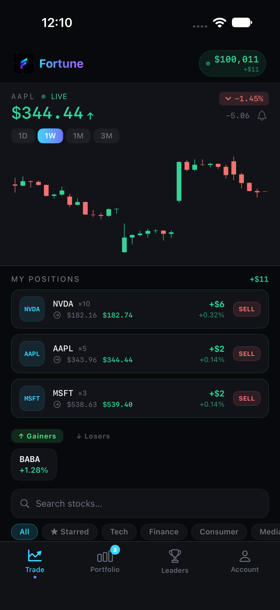
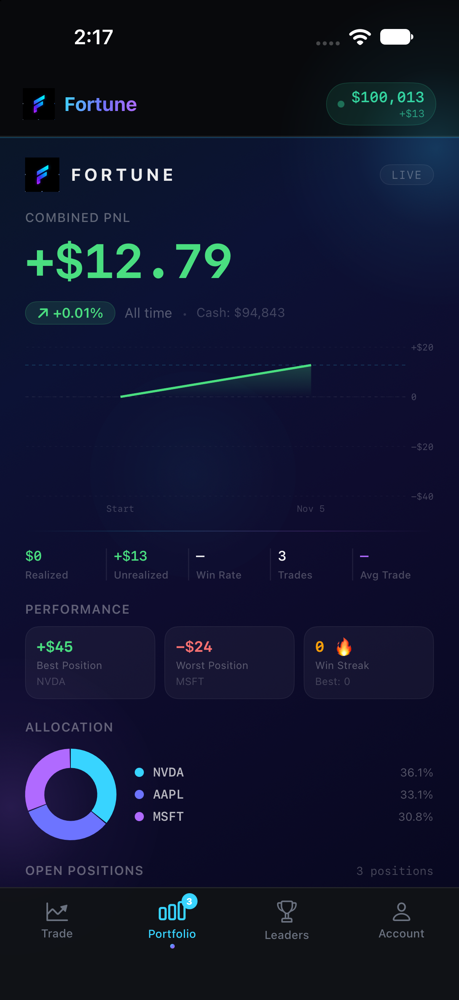
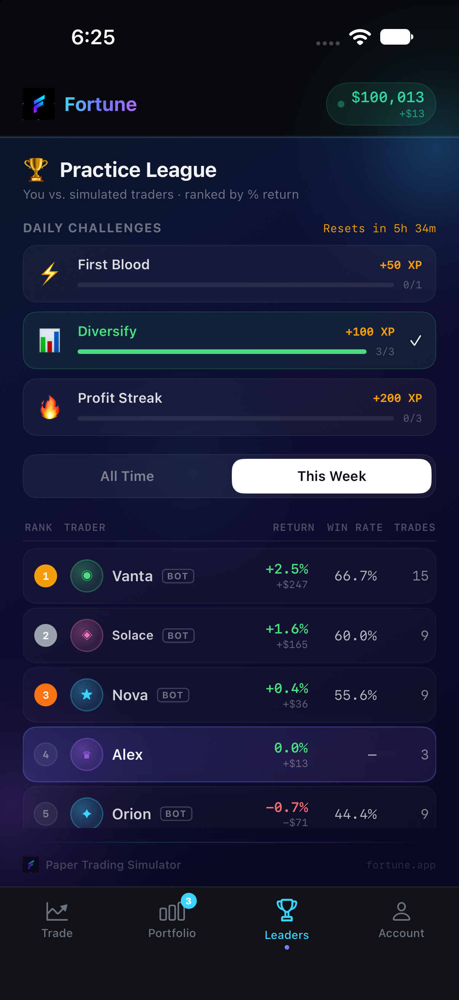
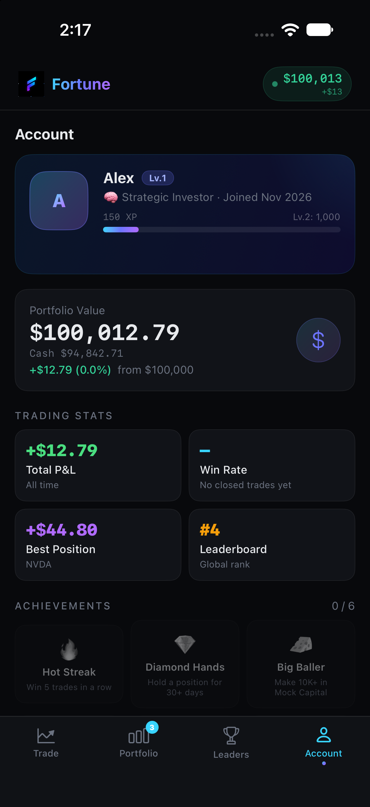

# Fortune — Stock Market Paper-Trading Simulator

Fortune is an iOS app for practicing stock trading with live market data and zero real money. You get a mock portfolio, buy and sell real stocks at live prices, set stop losses and take-profit targets, and compete on a leaderboard while earning XP and achievements.

Built entirely in **SwiftUI** with Swift Concurrency, Swift Charts, and the Observation framework.

<p align="center">
  
  &nbsp;
  
  &nbsp;
  
  &nbsp;
  
</p>

---

## Features

**Trading**
- Live quotes for 22 stocks across Tech, Finance, Consumer, Media, Crypto, and EV sectors
- Real-time price updates over a WebSocket feed, plus periodic REST refreshes
- Candlestick charts (1D / 1W / 1M / 3M) with the latest bar updated live
- Market orders with stop-loss and take-profit levels that **execute automatically** when price crosses them
- Partial sells, average-cost basis across multiple buys, and realized vs. unrealized P&L
- Price alerts that fire a notification when a target is crossed
- Search, sector filters, sorting, top movers, and a starred watchlist

**Portfolio**
- Combined P&L hero, equity curve, allocation donut chart, open positions, and a trade journal of every closed trade (manual, stop loss, or take profit)
- Market news feed

**Gamification**
- XP and levels earned from real trading activity
- Daily challenges (First Blood, Diversify, Profit Streak) that reset at midnight
- Achievements such as Hot Streak (5 wins in a row) and Night Owl (trades outside NYSE hours)
- Global and weekly leaderboard against simulated traders

**Personalization**
- 9-step onboarding that tailors the starting balance, default stop-loss / take-profit %, chart timeframe, sort order, and sector focus
- Local notifications for level-ups, big moves in held stocks, and stop-loss / take-profit fills
- Starred stocks sync across devices with iCloud key-value storage
- Everything persists on-device; no account or server required

---

## Tech Stack

| Area | Technology |
|------|------------|
| UI | SwiftUI, Swift Charts, Canvas (donut chart, confetti) |
| State | Observation (`@Observable`), single source of truth in `AppModel` |
| Concurrency | async/await, `actor`, `TaskGroup`, `AsyncStream` |
| Networking | `URLSession` REST + `URLSessionWebSocketTask` |
| Data | [Finnhub](https://finnhub.io) (quotes, fundamentals, news, live trades), Yahoo Finance (OHLC candles) |
| Persistence | `Codable` + `UserDefaults`, `NSUbiquitousKeyValueStore` for iCloud sync |
| Notifications | UserNotifications (local only) |
| Testing | Swift Testing (26 unit tests) |

---

## Architecture

```
Views (SwiftUI)  ──reads/writes──▶  AppModel (@Observable, MainActor)  ──async──▶  MarketService (actor)
  TradeView                          • portfolio & order engine                   • Finnhub REST + WebSocket
  PnLView                            • SL/TP execution, alerts                    • Yahoo Finance charts
  LeaderboardView                    • XP, challenges, achievements
  AccountView                        • persistence & iCloud sync
```

- **`AppModel`** owns all app state. Holdings, P&L, and the equity curve are *derived* from the order history rather than stored separately, so they can never drift out of sync.
- **`MarketService`** is an `actor`, so network work stays off the main thread and its state is isolated.
- **`NotificationManager`** wraps local notifications and checks authorization before sending.

### Engineering details

- **Rate-limit aware loading.** Finnhub's free tier allows 60 calls/minute. Quotes load first so the UI fills in within a second or two. Fundamentals (P/E, market cap, 52-week range, analyst rating) are then fetched in small batches with pauses between them. Rate-limited or empty responses are rejected so a `429` can never turn into a $0 price that falsely triggers a stop loss.
- **Throttled live feed.** Large-cap stocks trade thousands of times a minute. WebSocket updates are throttled to one UI update per symbol every 2 seconds and ignore sub-cent moves. The stream reconnects automatically.
- **Order engine.** Weighted average-cost basis, realized P&L on partial sells, and automatic stop-loss / take-profit execution that records the exit reason in the trade journal.
- **Testable by design.** `AppModel` accepts an injected `UserDefaults`, so each test runs against isolated storage.

---

## Getting Started

### Requirements
- Xcode 27 or later
- iOS 26.5+ (simulator or device)
- A free [Finnhub API key](https://finnhub.io/register)

### Setup
1. Clone the repo:
   ```bash
   git clone https://github.com/Kalmxz007/Fortune-iOS-App-Dev.git
   ```
2. Add your API key. Copy the template into the app folder and paste your key into it:
   ```bash
   cp Secrets.example.plist "Fortune Final V2/Secrets.plist"
   ```
   `Secrets.plist` is git-ignored, so your key stays on your machine.
3. Open `Fortune Final V2.xcodeproj` and run the **Fortune Final V2** scheme (⌘R).

> **iCloud sync (optional):** syncing starred stocks on a real device requires enabling **iCloud → Key-value storage** under *Signing & Capabilities* with your own team. Everything else works without it.

### Running tests
Press **⌘U** in Xcode, or run:
```bash
xcodebuild test -project "Fortune Final V2.xcodeproj" -scheme "Fortune Final V2" \
  -destination "platform=iOS Simulator,name=iPhone 18 Pro"
```
The tests cover cost basis, realized P&L, stop-loss / take-profit execution, win streaks, daily-challenge XP, price alerts, persistence across relaunches, NYSE market-hours detection, and number formatting.

---

## Project Structure

| File | Responsibility |
|------|----------------|
| `FortuneApp.swift` | App entry point |
| `RootView.swift` | Onboarding vs. main shell, header, tab bar, global toasts |
| `Models.swift` | `AppModel` (state, order engine, gamification, persistence) and domain types |
| `MarketService.swift` | Finnhub / Yahoo networking and the WebSocket live feed |
| `NotificationManager.swift` | Local notification permissions and delivery |
| `TradeView.swift` | Trade screen plus order, stock detail, and price alert sheets |
| `PnLView.swift` | Portfolio: P&L, equity curve, allocation, positions, journal, news |
| `LeaderboardView.swift` | Leaderboard and daily challenges |
| `AccountView.swift` | Profile, stats, achievements, settings, privacy policy |
| `OnboardingView.swift` | 9-step personalized onboarding |
| `TutorialView.swift` | In-app how-to guide |
| `Components.swift` | Shared views: badges, backgrounds, confetti, flow layout |
| `Theme.swift` | Colors, gradients, fonts, number formatting |
| `FortuneTests/` | Swift Testing unit tests |

---

## Roadmap

- Limit orders and short selling
- Portfolio history snapshots for a time-based equity curve
- Real multiplayer leaderboard via Game Center
- Widgets and Live Activities for open positions

---

## Disclaimer

Fortune is a simulator for educational and entertainment purposes. No real money is involved and no real trades are placed. Market data is provided by third parties and may be delayed or inaccurate.
